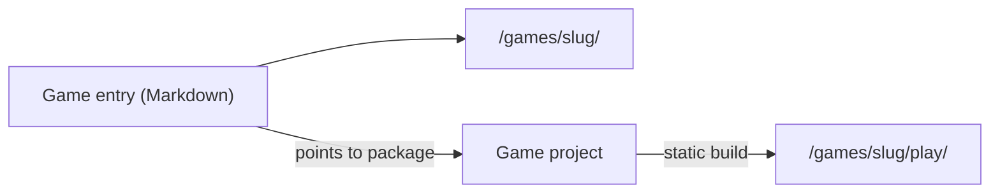

Wiki

# Cosmic Arcade

The arcade is a personal site of games. Each game is built in the engine that fits it, and the site gives all of them one front door.

## The problem: many engines, one home

A tower defense game wants a 2D engine. A deck builder is mostly cards and menus, so plain web pages fit it better. A JRPG can come from Godot. A tabletop RPG has no engine at all. If one site had to know every engine, each new game would change the site.

So the arcade has two halves that do not know about each other:

- **The [front door](architecture/front-door.md)** is an Astro site. It lists the games and gives each game a page for its design notes, devlog and marketing.
- **The games** are separate [game projects](architecture/game-project.md). Each one picks its engine, owns its tests, and builds to a folder of static files.

The [repo layout](architecture/repo-layout.md) shows where each half lives.

## How a game joins the arcade

A game joins when you add an entry to the games collection of the site. The entry is a Markdown page. Its metadata gives the title, the status and the platforms. Its body is the landing page of the game.

When the game has a build, the entry points to the game project by its package name. The site then publishes the build next to the landing page. Thus "Ember Keep" has its page at `/games/ember-keep/`, and you play it at `/games/ember-keep/play/`.

A tabletop RPG uses the same kind of entry with no build. Its page holds the rules and the downloads.

## Further reading

- [Project facts](standards/project.md): the facts that each workflow skill reads before it starts.
