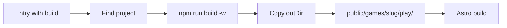

[Wiki](../README.md) / [Game project](game-project.md) / Publishing builds

# Publishing builds

Publishing puts the build of each game at its play URL. It runs each time the site builds. Only the games that the entries link to are built.

## Why the site builds the games

A build that you copy by hand gets old. You change the game, forget to copy, and the arcade shows last week's version. So the build of the site always builds the games first. What is in `games/` is what the arcade shows.

## The steps

1. The site reads each [game entry](game-entry.md) that has a `build` field.
2. It finds the project through the [build link](build-link.md).
3. It runs `npm run build -w <package name>`.
4. It copies the `outDir` of that project to `public/games/<slug>/play/`.
5. Astro builds the site. It copies everything in `public/` as it is.

The `public/games/` folder is made by these steps only. Git does not keep it.

An entry with no build, such as an idea or a [tabletop game](tabletop-games.md), skips these steps.

## Why the play page is not an Astro page

The site has no Astro page at the play URL. If it had one, the page and the copied files would compete for the same path. The play URL belongs to the build alone.

## While you develop

The dev server of the site shows the last published build. To work on a game, you run the dev command of that game project. You see the game in the site only after the next build.

## An example

The entry `ember-keep` has `build: "@arcade/td-phaser"`. The site runs `npm run build -w @arcade/td-phaser`. Vite writes `games/td-phaser/dist/`. The site copies it to `public/games/ember-keep/play/`. After the build, `/games/ember-keep/play/` opens the game.

## Further reading

- [Game URLs](game-urls.md): all the paths that the arcade publishes.
- [Front door](front-door.md): why the site never imports game code.
