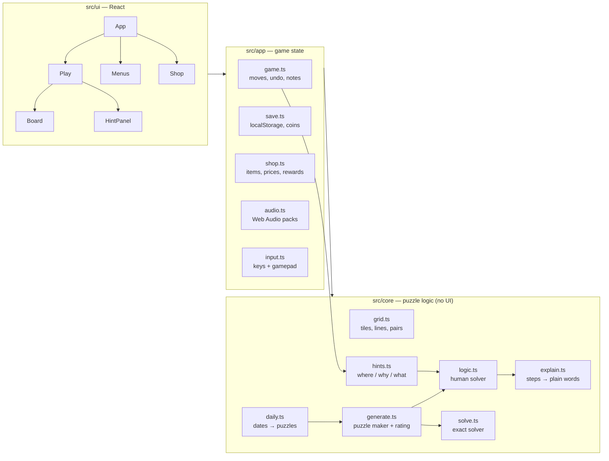
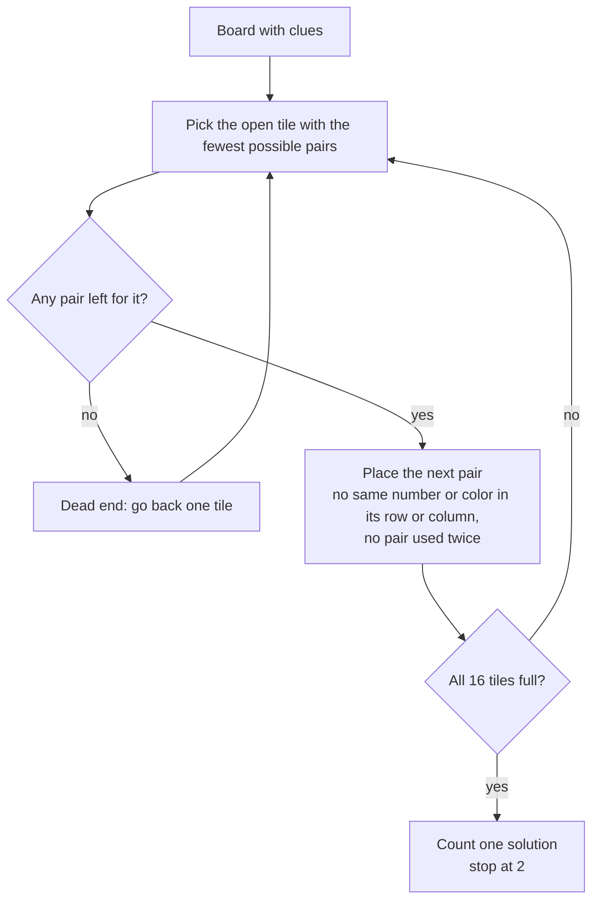
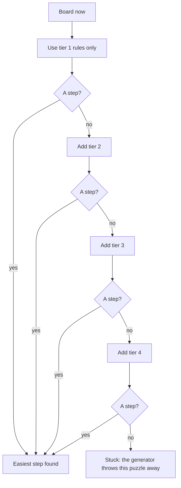
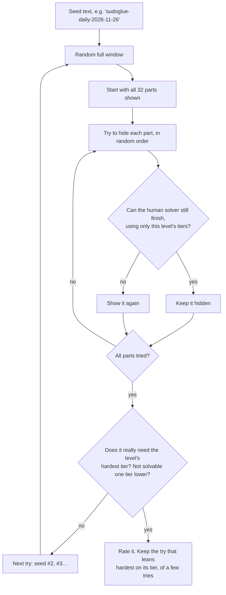
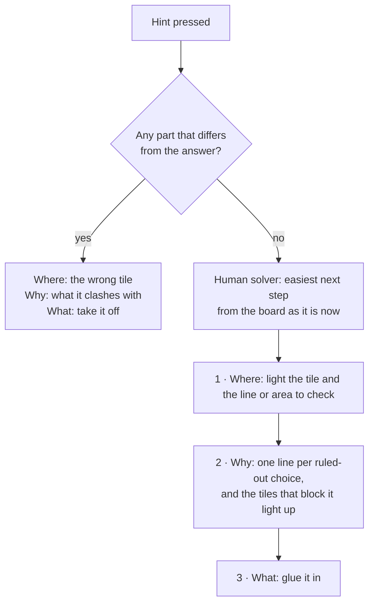

# Mozzi

A daily logic puzzle: fill a small mosaic window by giving each of its 16 tiles one number (1–4) and one color. Mozzi, a creature made of four tiles, keeps you company and gives the hints. (The game was first called Sudoglue.)

**Rules.** Each row and each column has every number once and every color once. Each number + color pair (like "ruby 2") is used once in the whole window. No boxes. Some parts start locked ("set in lead"): those are the clues.

TypeScript, React and Vite. The puzzle logic has no UI code and runs in Node for tests.

## Run it

| Command | What it does |
| ------- | ------------ |
| `npm run dev -w mozzi` | Dev server on port 4015. |
| `npm test -w mozzi` | Builds and checks 590 puzzles (about 15 s). |
| `npm run compare-controls -w mozzi` | Counts the inputs of the two control styles. |
| `npm run build -w mozzi` | Tests, type check, then a static build in `dist/`. |
| `npm run icons -w mozzi` | Redraws the app icons from one SVG (uses `sharp`, already in the repo). |

The arcade serves the build from `/games/mozzi/play/`. The title screen links back with `../`.

## Folders

| Path | Holds |
| ---- | ----- |
| `src/core/` | Pure logic. Tiles are numbered 0–15 (row × 4 + column). Numbers and colors are 0–3. A pair is `number × 4 + color`. |
| `src/app/game.ts` | One window being played: every move is `step(state, action)`, which returns a new state plus events (for sound, effects and screen-reader messages). |
| `src/app/shop.ts` | Every shop item, price and coin reward, as data. |
| `src/ui/Board.tsx` | The window: a 4×4 grid of HTML buttons. All its looks come from CSS tokens. |
| `src/ui/Play.tsx` | The play screen (layout C), hint and pairs sheets, results and the tutorial. |
| `src/ui/Mozzi.tsx` | The mascot and its moods. |
| `src/style.css` | Themes (`[data-theme]`), tile styles (`[data-tiles]`), layout and motion. |
| `scripts/` | Tests and the control-style comparison. |

## The exact solver

`solve.ts` is the judge. It tries every option with backtracking, so it can say "exactly one solution". Players never see it.

It also makes new full windows: run it on an empty grid with the pairs in a random order. There are only **6,912** finished 4×4 windows in all.

## The human solver

`logic.ts` only uses rules a person can follow. Each tile keeps a list of the 16 pairs it could still hold. Rules remove pairs and remember **why**. A step is found when a line, a tile or a pair has one option left.

The rules come in four tiers, easiest first:

| Tier | Rule | In plain words |
| ---- | ---- | -------------- |
| 1 | Lines | A row or column has each number and each color once. |
| 2 | Used pairs | A finished pane uses up its pair. It can't appear again. |
| 3 | Pair hunt | Every pair must go somewhere. If only one tile can hold it, it goes there. |
| 4 | Trades | Any two rows (or columns) trade their numbers in pairs, and their colors too. |

At each tier it looks for steps in this order:

1. **Only spot**: in a row or column, a number (or color) has one tile left.
2. **Last option**: a tile has one number (or color) left.
3. **Pair hunt** (tier 3+): a pair has one tile left.

### Why "trades" is true

Take any two rows of a finished window. Where row 1 has a 2 and row 3 has a 4, then somewhere else row 1 has a 4 and row 3 has a 2. The numbers swap in pairs, never in a longer loop like 1→2→3→4→1.

We checked all 6,912 windows by computer, and it holds in every one (rows, columns, numbers and colors). The reason: a 4×4 number grid that has a "loop" between two rows can never be matched with a color grid that uses all 16 pairs. Only grids with the swap shape can. (Mathematicians call these the cyclic and the Klein-four kinds of 4×4 Latin square.) You don't need the proof to use it: it's a pattern you can see and lean on.

**Why we needed it.** With the first three tiers, about half of all minimal puzzles get stuck: they have one solution, but no simple rule finds the next step. With trades, every one we tried can be solved: of 1,000 random minimal puzzles (cut down until any more hiding would allow a second answer), 33% need used pairs at most, 14% need a pair hunt, 54% need trades, and none get stuck. The tests repeat this on 300 more. We also tried "twins" (two tiles in a line that share the same two options). In 4×4 it never found anything the other rules missed, so it was left out.

## The generator

Because the human solver only makes true deductions, "it can finish" also means "exactly one solution". The tests check that again with the exact solver.

The same seed always gives the same puzzle, so everyone gets the same daily window. Practice puzzles use `sudoglue-practice-<level>-<n>`. (The seeds keep the first name on purpose: changing them would change every puzzle.)

## Hints

- Hints ignore pencil notes, since notes may be wrong.
- Every "why" says what blocks each other choice. For example: *Where can 3 go in column D? Not D2: row 2 already has 3 at A2.* Tile names, numbers and colors are drawn as chips, with each color's pattern, so color is never the only cue.
- **Why hints never get stuck.** The generator only keeps puzzles the solver finishes from the clues. A board with more correct parts only gives the rules more to work with, so the solver still finds a step. The tests follow hints alone from the clues and from many random part-filled boards, to the end.

## Difficulty, honestly

Levels go by the hardest rule a puzzle needs, and the generator checks the puzzle can't be solved one tier lower. From 590 test puzzles:

| Level | Needs | Clues | Steps of the hardest rule |
| ----- | ----- | ----- | ------------------------- |
| Easy | Lines | 10–12 | all ~21 |
| Medium | Used pairs | 6–8 | 6–8 |
| Hard | Pair hunt | 6 | always exactly 1 |
| Expert | Trades | 6–8 | 1–3 |

What 4×4 can and can't do:

- **Easy vs Medium is a clear jump**: half the clues, and you must track pairs.
- **Medium → Hard → Expert are real but narrow**: each adds one new kind of thinking, but only at one to three key moments. A 4×4 grid is small; no try gave Hard more than one pair-hunt moment.
- Clue count alone would be a poor guide: Medium, Hard and Expert all start with 6–8 clues.

Daily levels by weekday live in `WEEKDAY_LEVEL` (`src/core/daily.ts`): Mon Easy, Tue–Wed Medium, Thu–Fri Hard, Sat–Sun Expert.

## Controls and layout

Version 1 tried two control styles, counting the inputs to fill real puzzles in the order the hint solver fills them (`npm run compare-controls`):

| Style | How it works | Taps per puzzle |
| ----- | ------------ | --------------- |
| **A. Tile first (kept)** | Pick a tile, then tap a number and a color. | 47.9 (keyboard: 65.8 presses) |
| B. Pane first ("brush") | Arm a number or a color, then tap tiles to paint it. | 51.2 (33.3 if you paint each value in one go) |

Tile first won: fewer taps in a natural order, and it works the same with a keyboard and a gamepad.

Version 2 kept tile first and picked the layout with two prototypes (see the [decision log](../../docs/initiatives/mozzi/v2/decision-log.md)). The winner is **layout C, the thumb zone**:

- **Top bar:** pause, the clock, then undo, redo, notes, erase and hint. On phones narrower than 380px redo hides (Y still redoes).
- **Board:** takes all the space that is left, as a square.
- **Status line:** notes on or off, and a **Pairs** chip that opens a sheet with all 16 pairs.
- **Numbers row and colors row** at the bottom, in reach of the thumb. They show used pairs in context: when the picked tile is a 2, every color already used with 2 elsewhere is faded and checked. The same works the other way for numbers.
- **Hint:** opens as a sheet in place of the two rows. The board shrinks but stays in view, so the highlights are always visible.
- **Sideways and desktop:** the board on the left, the rows (or the hint) on the right.

## Look and feel

Soft clay: puffy tiles that press down, calm flat colors, no hard outlines. The colors are tuned to stay apart for color-blind players (see Accessibility), and the **Color shapes** setting adds a symbol to each: ● ruby, ▲ cobalt, ■ amber, ◆ jade.

- **Placing:** a new number pops in, a new color flows out from the middle of the tile, and a tile with both squishes as glue drops squeeze out.
- **No early praise:** a full row or column gets no effect. It only means no rule is broken yet, not that it is right, so the only celebration is the solved window.
- **Solved:** the tiles ripple and colored light turns slowly behind the window, with confetti.
- **Clashes:** a red ring and a small shake.
- **Clues:** bold numbers; clue colors carry a small bar in the corner.
- **Smooth motion:** effects on a tile (squish, shake, hint flash, the solved ripple) run on its inner face, so they never fight the tile's lift and press.
- **Reduced motion** (setting, or the device setting): animations stop; the solved glow holds still.

## Mozzi

Mozzi is four tiles in a 2×2 body, one per color, with a face across them. It is drawn in HTML and CSS (`src/ui/Mozzi.tsx`), so it always wears the current theme and tile style.

| Moment | What Mozzi does |
| ------ | --------------- |
| You pick a tile | Its eyes look toward that tile. |
| A number or color goes in | A quick squash; the tile of that color hops. |
| A tile gets both parts | A bigger squish, with the glue drops. |
| A clash | Squeezed eyes and a shiver. |
| You touch a clue | A flat mouth and a head shake. |
| You ask for a hint | It looks up, thinking, then talks in the hint card while the hint shows. Tap Mozzi in the status line for a hint too. |
| 25 seconds with no move | It dozes off, and wakes on your next move. |
| The window is mended | The four tiles burst apart and snap back, over and over. |
| Title screen | Big Mozzi follows your pointer with its eyes; tap it to say hello. |

## Shop, coins, themes, tiles and sounds

Coins come from mended windows (each window pays once): 10/15/20/30 by level, +10 with no hints, +5 for a new best time, +5 for today's window, and +2 per streak day (up to +10). Hints are always free.

| Kind | Items (price) |
| ---- | ------------- |
| Themes | Linen (free), Dusk (free, dark), Meadow 60, Blossom 60, Deep Sea 90 (dark), Ember 90 (dark) |
| Tile styles | Clay (free), Paper 80, Glass 120, Gem 150 |
| Sound packs | Glass Bells (free), Kalimba 100, Felt Piano 100 |

A theme is a block of color tokens in `style.css`; a tile style is a block of shape tokens (radius, shadow, sheen). Because they are tokens, the shop can draw a preview of any theme or tile style inside the page.

### Sound

All sound is made in code with Web Audio (`src/app/audio.ts`). Each sound pack is one instrument: soft glass bells, a wooden kalimba, or a felt piano. Every effect and the music play on that instrument, on one G-major pentatonic scale. To keep it soft: no raw noise bursts, no sharp attacks, a low-pass filter on every voice, a small room reverb, and quiet levels. The music is a slow, sparse melody over warm pad chords (Gmaj7, Em7, Cmaj7, Dsus).

## Accessibility

- The board is a grid for screen readers; each tile reads its name and contents ("B2, 3, ruby, clue").
- A polite live region says what happened: placements, clashes, finished lines, hints (the full why), and the end.
- Full keyboard and gamepad play; focus rings follow the theme's accent.
- **Colors that stay apart.** Each theme's four colors, and its empty tile, are tuned to differ mostly in lightness, so they stay apart under normal vision and the three common kinds of color blindness (protanopia, deuteranopia, tritanopia). `scripts/check-colors.ts` checks this on every `npm test`: it simulates each kind (Machado et al. 2009), measures the smallest color distance (CIELAB ΔE), and fails below 18. It also checks the number ink has a contrast of at least 3.5:1 on every color. Before tuning, ruby and jade were almost the same for deuteranopia (ΔE about 5); now the smallest distance is 21 or more.
- **Color shapes** setting (off by default, and on by itself when the device asks for more contrast): ● ruby, ▲ cobalt, ■ amber, ◆ jade, on the tiles, the color keys, notes, the pairs sheet and hint text. Color names also show on the color keys.
- **Big numbers** setting; buttons are at least 38px (most are 42–68px).
- Two free themes, one light and one dark.
- Reduced motion follows the device, or can be set by hand.

## Offline app (PWA)

Mozzi installs as an app and plays offline, the same way as Wordkin:

- `vite.config.ts` writes `sw.js` at build time with the exact list of files to keep: the game, the styles, the icons, the manifest, and only the Latin font files (18 files). A new build gets a new cache name, and old caches are removed.
- `public/manifest.webmanifest` gives the name, colors and icons; `public/icons/` holds the icons, drawn by `scripts/make-icons.ts` (Mozzi on a soft tile, plus maskable and Apple touch versions).
- `src/app/pwa.ts` registers the service worker, shows **Install** on the title screen when the browser offers it, and shows "Update ready. Tap to reload." when a new build is waiting. Once installed, it asks the browser to keep the save even when storage runs low.
- The dev server has no service worker. Add `?dev` to a build URL to turn it off there too.
- On an iPhone or iPad there is no install prompt: use Share, then Add to Home Screen. How to play says so.

## Save data

One localStorage entry, `mozzi:v1` (an old `sudoglue:v1` save moves over on the first load): settings, windows in progress, finished windows, best 5 times per level (with hints used), the next practice number per level, the daily streak, coins, owned items, the theme, tile style and sound pack in use, and whether the tutorial was seen. A daily counts for the streak when it is finished on its own day.

## Tuning knobs

| What | Where |
| ---- | ----- |
| Tier each level needs | `LEVEL_TIER` in `src/core/generate.ts` |
| Tries per puzzle (tougher Hard/Expert) | `TRIES` in `src/core/generate.ts` |
| Score weight per tier | `STEP_WEIGHT` in `src/core/generate.ts` |
| Level per weekday | `WEEKDAY_LEVEL` in `src/core/daily.ts` |
| Shop items, prices, coin rewards | `CATALOG` and `EARN` in `src/app/shop.ts` |
| Theme colors, tile shapes | `[data-theme]` and `[data-tiles]` blocks in `src/style.css` |
| Sound packs and music | `PACKS`, `SOUNDS` and `Engine` in `src/app/audio.ts` |

## Tests

`npm test` runs `scripts/test-puzzles.ts` and `scripts/check-colors.ts` (see Accessibility). The puzzle test checks 130 practice puzzles per level and 70 daily puzzles (590 in all). For each:

- exactly one solution, and it matches the stored answer;
- the human solver finishes it, and every part it places is right;
- every "ruled out" reason is true on the board, and no reason ever rules out the real answer;
- it needs its level's tier, and is not solvable one tier lower;
- hints alone finish it from the clues, and from 4 random part-filled boards;
- every "only spot" and "last option" hint explains all 3 other choices;
- a wrong entry is pointed out before any new step;
- a daily puzzle comes out the same every time.

It also cuts 300 random puzzles down to minimal (using only the exact solver) and checks the hint rules solve every one.
