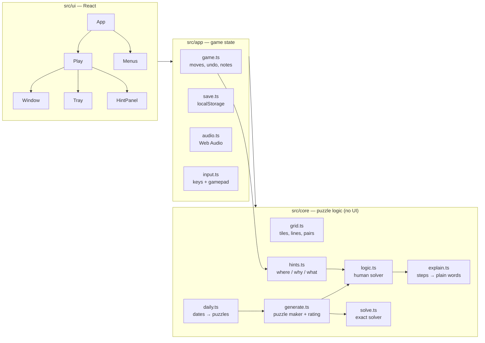
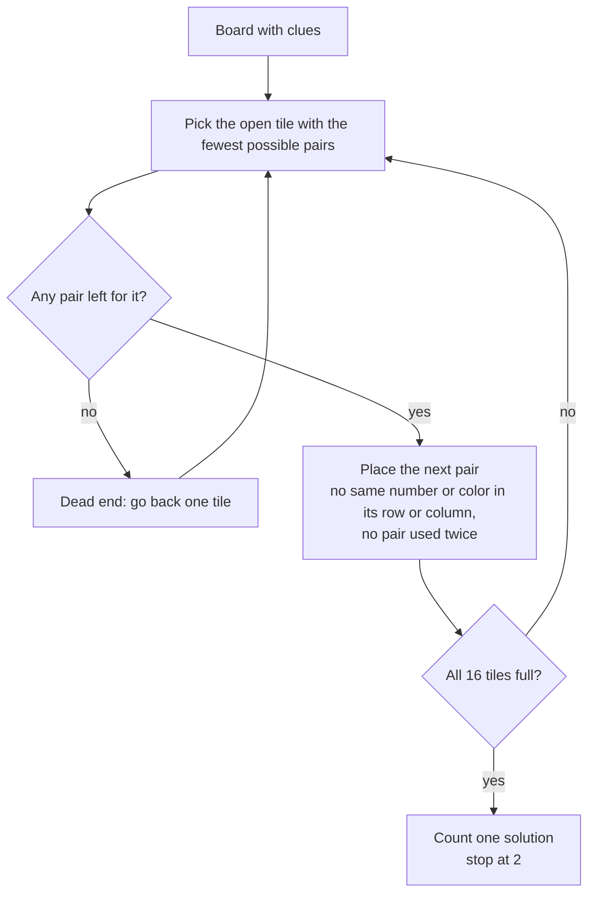
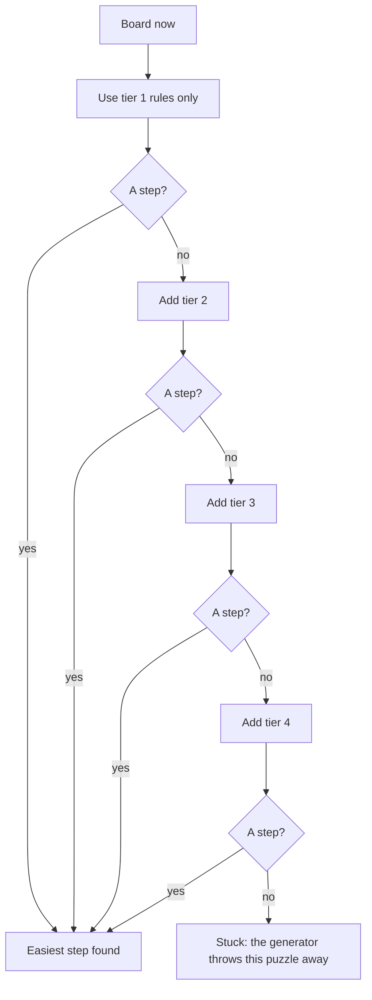
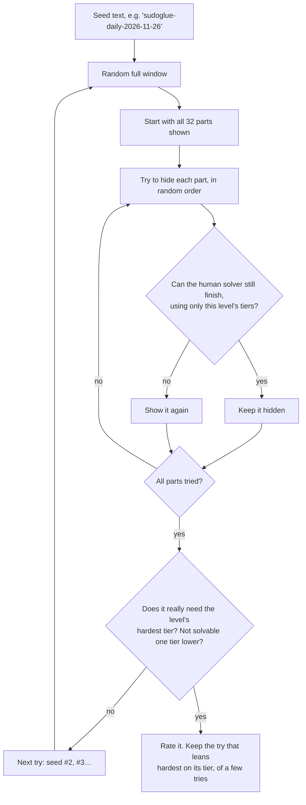
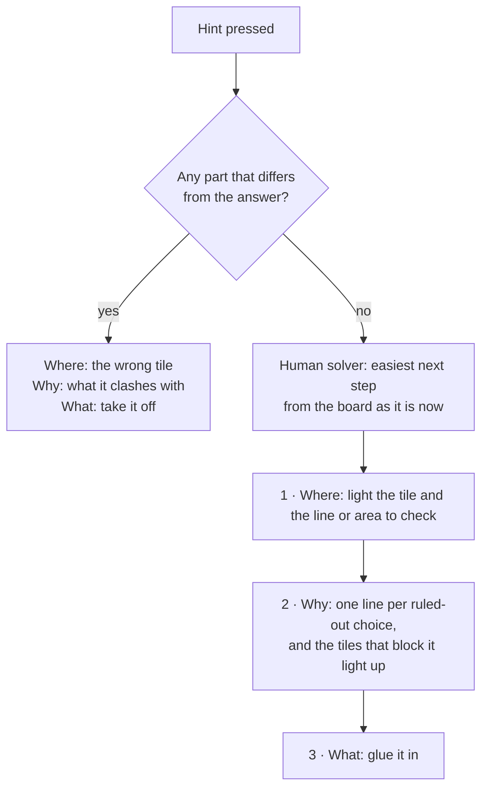

# Sudoglue

A daily logic puzzle. Glue the broken stained-glass windows of an old workshop back together: give each of the 16 panes one number (1–4) and one glass color.

**Rules.** Each row and each column has every number once and every color once. Each number + color pair (like "ruby 2") is used once in the whole window. No boxes. Some parts start locked ("set in lead"): those are the clues.

TypeScript, React and Vite. The puzzle logic has no UI code and runs in Node for tests.

## Run it

| Command | What it does |
| ------- | ------------ |
| `npm run dev -w sudoglue` | Dev server on port 4015. |
| `npm test -w sudoglue` | Builds and checks 590 puzzles (about 15 s). |
| `npm run compare-controls -w sudoglue` | Counts the inputs of the two control styles. |
| `npm run build -w sudoglue` | Tests, type check, then a static build in `dist/`. |

The arcade serves the build from `/games/sudoglue/play/`. The title screen links back with `../`.

## Folders

| Path | Holds |
| ---- | ----- |
| `src/core/` | Pure logic. Tiles are numbered 0–15 (row × 4 + column). Numbers and colors are 0–3. A pair is `number × 4 + color`. |
| `src/app/game.ts` | One window being played: every move is `step(state, action)`, which returns a new state plus events (for sound and effects). |
| `src/ui/` | The window (one SVG), the controls, hints, menus, the particle canvas, and Gloop the glue bottle. |
| `src/ui/art.ts` | Glass colors, patterns, hand-drawn numerals, the window shape. All art is drawn in code. |
| `scripts/` | Tests and the control-style comparison. |

## The exact solver

`solve.ts` is the judge. It tries every option with backtracking, so it can say "exactly one solution". Players never see it.

It also makes new full windows: run it on an empty grid with the pairs in a random order. There are only **6,912** finished 4×4 windows in all.

## The human solver

`logic.ts` only uses rules a person can follow. Each tile keeps a list of the 16 pairs it could still hold. Rules remove pairs and remember **why**. A step is found when a line, a tile or a pair has one option left.

The rules come in four tiers, easiest first:

| Tier | Rule | In plain words |
| ---- | ---- | -------------- |
| 1 | Lines | A row or column has each number and each color once. |
| 2 | Used pairs | A finished pane uses up its pair. It can't appear again. |
| 3 | Pair hunt | Every pair must go somewhere. If only one tile can hold it, it goes there. |
| 4 | Trades | Any two rows (or columns) trade their numbers in pairs, and their colors too. |

At each tier it looks for steps in this order:

1. **Only spot**: in a row or column, a number (or color) has one tile left.
2. **Last option**: a tile has one number (or color) left.
3. **Pair hunt** (tier 3+): a pair has one tile left.

### Why "trades" is true

Take any two rows of a finished window. Where row 1 has a 2 and row 3 has a 4, then somewhere else row 1 has a 4 and row 3 has a 2. The numbers swap in pairs, never in a longer loop like 1→2→3→4→1.

We checked all 6,912 windows by computer, and it holds in every one (rows, columns, numbers and colors). The reason: a 4×4 number grid that has a "loop" between two rows can never be matched with a color grid that uses all 16 pairs. Only grids with the swap shape can. (Mathematicians call these the cyclic and the Klein-four kinds of 4×4 Latin square.) You don't need the proof to use it: it's a pattern you can see and lean on.

**Why we needed it.** With the first three tiers, about half of all minimal puzzles get stuck: they have one solution, but no simple rule finds the next step. With trades, every one we tried can be solved: of 1,000 random minimal puzzles (cut down until any more hiding would allow a second answer), 33% need used pairs at most, 14% need a pair hunt, 54% need trades, and none get stuck. The tests repeat this on 300 more. We also tried "twins" (two tiles in a line that share the same two options). In 4×4 it never found anything the other rules missed, so it was left out.

## The generator

Because the human solver only makes true deductions, "it can finish" also means "exactly one solution". The tests check that again with the exact solver.

The same seed always gives the same puzzle, so everyone gets the same daily window. Practice puzzles use `sudoglue-practice-<level>-<n>`.

## Hints

- Hints ignore pencil notes, since notes may be wrong.
- Every "why" says what blocks each other choice. For example: *Where can 3 go in column D? Not D2: row 2 already has 3 at A2.* Tile names, numbers and colors are drawn as chips, with each color's pattern, so color is never the only cue.
- **Why hints never get stuck.** The generator only keeps puzzles the solver finishes from the clues. A board with more correct parts only gives the rules more to work with, so the solver still finds a step. The tests follow hints alone from the clues and from many random part-filled boards, to the end.

## Difficulty, honestly

Levels go by the hardest rule a puzzle needs, and the generator checks the puzzle can't be solved one tier lower. From 590 test puzzles:

| Level | Needs | Clues | Steps of the hardest rule |
| ----- | ----- | ----- | ------------------------- |
| Easy | Lines | 10–12 | all ~21 |
| Medium | Used pairs | 6–8 | 6–8 |
| Hard | Pair hunt | 6 | always exactly 1 |
| Expert | Trades | 6–8 | 1–3 |

What 4×4 can and can't do:

- **Easy vs Medium is a clear jump**: half the clues, and you must track pairs.
- **Medium → Hard → Expert are real but narrow**: each adds one new kind of thinking, but only at one to three key moments. A 4×4 grid is small; no try gave Hard more than one pair-hunt moment.
- Clue count alone would be a poor guide: Medium, Hard and Expert all start with 6–8 clues.

Daily levels by weekday live in `WEEKDAY_LEVEL` (`src/core/daily.ts`): Mon Easy, Tue–Wed Medium, Thu–Fri Hard, Sat–Sun Expert.

## Controls: what we tried

| Style | How it works | Taps per puzzle* |
| ----- | ------------ | ---------------- |
| **A. Tile first (kept)** | Pick a tile, then tap a number and a color. | 47.9 (keyboard: 65.8 presses) |
| B. Pane first ("brush") | Arm a number or a color, then tap tiles to paint it. | 51.2 (33.3 if you paint each value in one go) |

\* Inputs to place every part, in the order the hint solver places them. From `npm run compare-controls`.

Tile first won: fewer taps in a natural order, it works the same on keyboard and gamepad (the cursor is a tile), and you always look at one tile and its options. The brush only wins if you already know where every copy of a value goes. It is kept as a dev-only prototype: open the dev server with `?controls=brush`.

## Feel

- **Placing** a pane: it drops in with a squish, glue squeezes out (particles), then a click. Clues are "set in lead" (dark number badge, corner rivets). Your panes show a glue bead and a drip.
- **A full, clean row or column** catches the light: a sweep of light across it, glints, a shimmer.
- **Rose window**: each petal lights when all four panes of its color are in.
- **Solved**: the window glows with moving color, glass confetti, a chord.
- **Clashes** crack the panes involved and Gloop, the glue bottle, winces.
- **Patterns**: ruby has stripes, cobalt waves, amber dots, jade checks.
- **Reduced motion** (setting, or the device setting): no squish, shake, sweep or bobbing; fades stay; the solved glow holds still.

All sound is made in code with Web Audio (`src/app/audio.ts`): soft glass bells and wooden tocks on a G-major pentatonic scale, a little filtered noise for glue, and a slow music box over pad chords.

## Save data

One localStorage entry, `sudoglue:v1`: settings, windows in progress, finished windows, best 5 times per level (with hints used), the next practice number per level, the daily streak, and whether the tutorial was seen. A daily counts for the streak when it is finished on its own day.

## Tuning knobs

| What | Where |
| ---- | ----- |
| Tier each level needs | `LEVEL_TIER` in `src/core/generate.ts` |
| Tries per puzzle (tougher Hard/Expert) | `TRIES` in `src/core/generate.ts` |
| Score weight per tier | `STEP_WEIGHT` in `src/core/generate.ts` |
| Level per weekday | `WEEKDAY_LEVEL` in `src/core/daily.ts` |
| Glass colors and patterns | `GLASS` in `src/ui/art.ts` and `GlassDefs` in `src/ui/bits.tsx` |
| Sounds and music | `SOUNDS` and `Engine` in `src/app/audio.ts` |

## Tests

`npm test` (`scripts/test-puzzles.ts`) checks 130 practice puzzles per level and 70 daily puzzles (590 in all). For each:

- exactly one solution, and it matches the stored answer;
- the human solver finishes it, and every part it places is right;
- every "ruled out" reason is true on the board, and no reason ever rules out the real answer;
- it needs its level's tier, and is not solvable one tier lower;
- hints alone finish it from the clues, and from 4 random part-filled boards;
- every "only spot" and "last option" hint explains all 3 other choices;
- a wrong entry is pointed out before any new step;
- a daily puzzle comes out the same every time.

It also cuts 300 random puzzles down to minimal (using only the exact solver) and checks the hint rules solve every one.
